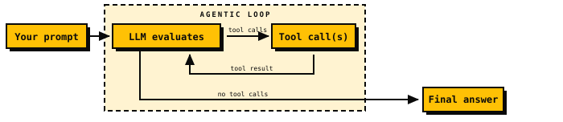
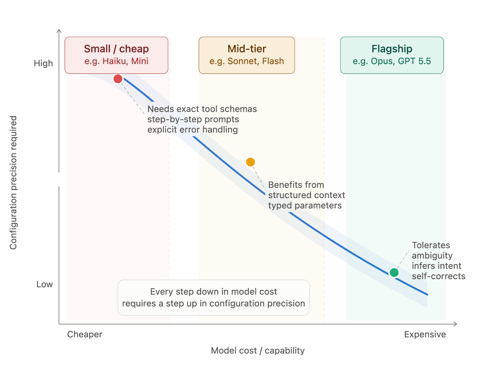
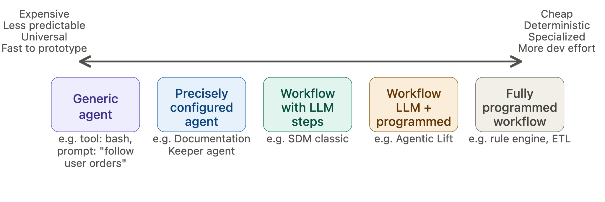

<!-- _class: title -->
<!-- _paginate: false -->

Agent Fight Club

Agent Anatomy

LOOP · LLM · TOOLS
AGENTFIGHTCLUB.TODAY

---

<!-- _class: watch big -->

## Agenda

1. Introduction round
2. Part 1: Theory & First steps of agent building
3. Part 2: Build & Compete

---

## Introduction round

// 01

🙋

Who are you?

// 02

🎯

What do you expect from the event and community?

---

<!-- _class: equation -->

## What does an agent consist of?

Agent =

↻

Loop

+

🧠

LLM

+

🔌

Environment interaction(Tools)

---

<!-- _class: bigtitle -->

📐

// Part 1

# Theory & first steps of agent building

---

<!-- _class: repo -->

Clone the repo please

// git remote

https://github.com/neuromaxer/agent-meetup

---

<!-- _class: watch big -->

## Agenda

1. What is an Agent?
2. What is a Harness?
3. What's under the hood of a coding harness?
4. Existing harnesses like **pi**, **OpenCode**

---

<!-- _class: roadmap -->

## Long-term agenda

01

TodayAgent FoundationsAgent loop + basic tools

02

More harness featuresSkills, MCP, hooks

03

Agent memory &amp; search

04

Subagents and loops

05

Harness internalsCompaction, sandboxes, LLM tokenomics

06

Agent toolingObservability, integrations

07

Self-improving agentse.g. Hermes, OpenClaw

08

Dark factories &amp; the future of work

---

<!-- _class: llm -->

## LLM basics

Machine learning model
Trained on data to predict something.

Neural network
One way to build that model.

LLM
A neural network trained on an internet-scale corpus of text — to predict the next word (token).

// next-token prediction

"Hello my name _" 
→ "is"

Text in

→

LLM

→

Text out

⚠ Stateless
No memory between calls. It just continues whatever input you gave it — every single time.

<!--
Speaker: Text in, text out — that's the whole interface (setting multi-modal aside for now).
Statelessness is the key point for what comes next: if the model remembers nothing, then the
loop and the context we hand it are entirely our job. That's what makes an agent an agent.
-->

---

<!-- _class: loop -->

## The agent loop

LoopThe model keeps calling tools until it has nothing left to call.

ExitNo tool calls means it's done — that's the final answer.

<!--
Speaker: This is the whole trick. The model is stateless, so each turn we hand it the prompt
plus everything that happened so far. It either asks for a tool, or it answers. Feeding the
tool result back in is the loop — and that loop is the harness, not the model.
-->

---

<!-- _class: whatis -->

## What is an Agent?

A software system that can <strong>perceive</strong> information, <strong>reason</strong> about it, and <strong>take actions</strong> to achieve a goal — often with limited human input.

Agent =

Model

Contains the intelligence.

+

Harness

Makes that intelligence useful.

If it's not the model, it's the harness

<strong>Harness engineering</strong> is how we build systems around models to turn them into work engines.

<!--
Speaker: This is the framing for the whole series. The model is a stateless text predictor —
we just saw that. Everything else, the loop, the tools, the context, the memory, is harness.
That division is why "if it's not the model, it's the harness" is a useful test.
-->

---

<!-- _class: bigtitle -->

⚔️

// Part 2

# Build & compete

---

<!-- _class: bigtitle -->

💬

// Wrap

# Feedback / Conclusion

---

<!-- _class: divider -->

# Appendix

Reference material

---

<!-- _class: plate tall -->

## Agent configuration precision trade-off

---

<!-- _class: plate wide -->

## AI solution rigidness trade-off

---

<!-- _class: watch big -->

## Game playing agent options

1. Tune your simple agent manually
2. Make coding agent to write game playing agent
3. Use coding agent as your agent (maybe expose later)

---

<!-- _class: watch big -->

## Practical tips

1. Pi as example
2. For safer daily usage use more mainstream harnesses (**Claude Code**, **Codex**, **opencode**)
